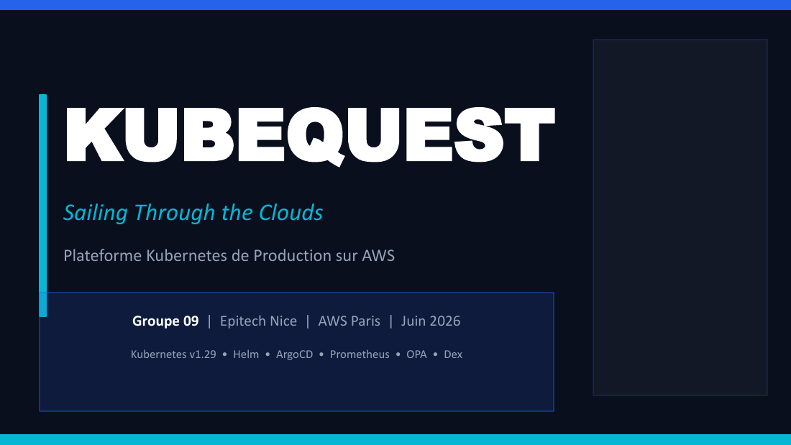
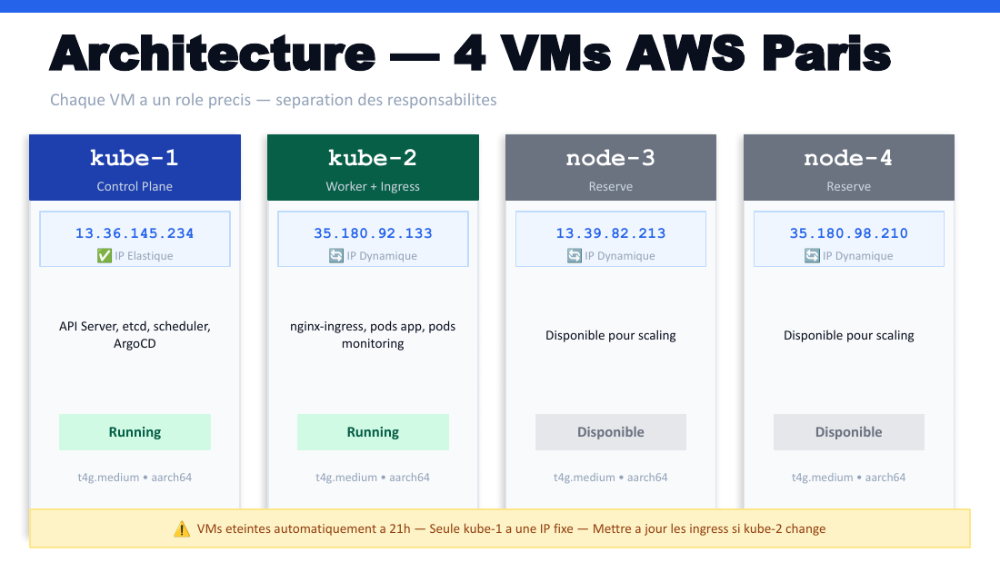
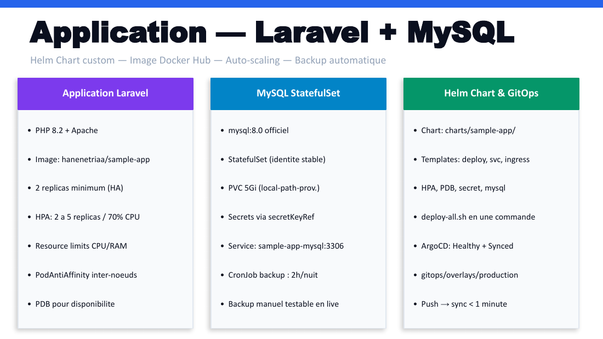
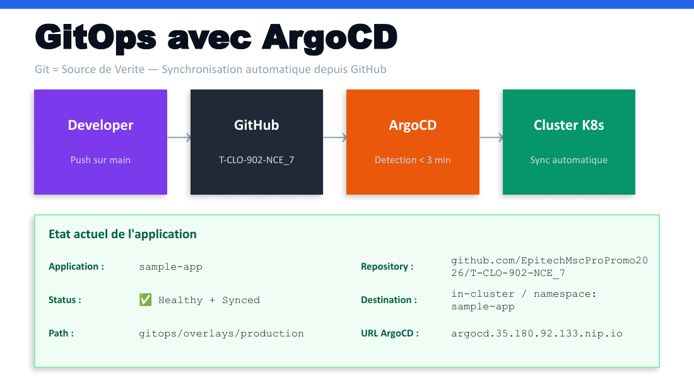
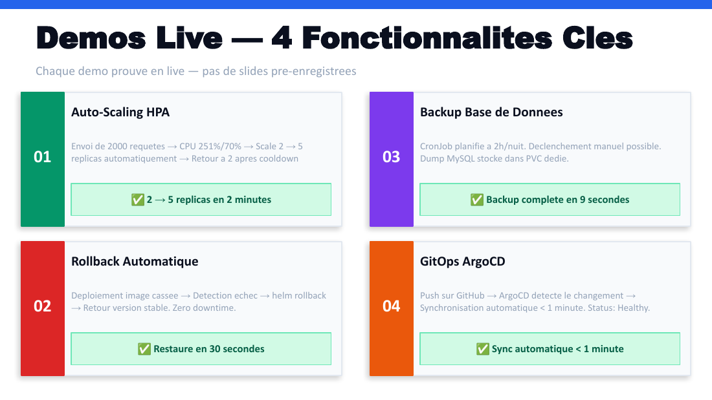

# KubeQuest : infrastructure Kubernetes sur AWS

Projet réalisé en équipe dans le cadre de mon Master Architecte des Systèmes d'Information (EPITECH Nice).

<p align="center"></p>

Déploiement d'une infrastructure Kubernetes complète et industrialisable sur AWS : cluster, monitoring, logging, sécurité, GitOps et déploiement d'application, en partant de zéro sur des instances EC2 vierges.

## Objectif du projet

Mettre en place, de A à Z, les briques essentielles d'une plateforme Kubernetes de production :
- Cluster multi-nœuds avec `kubeadm`
- Ingress, monitoring, logging
- GitOps avec ArgoCD
- Sécurité (OPA Gatekeeper, authentification OIDC)
- Auto-scaling et résilience (rollback automatique)

## Architecture

| Instance | Rôle | Services |
|---|---|---|
| kube-1 | Control Plane | API Server, etcd, scheduler |
| kube-2 | Worker + Ingress | nginx-ingress, pods app, monitoring |

- **Cloud** : AWS (région Paris eu-west-3)
- **Kubernetes** : v1.29.15 (kubeadm, Amazon Linux 2023)
- **Réseau** : Flannel CNI

> Le cluster de démonstration a depuis été démantelé (instances EC2 arrêtées) pour éviter les coûts. Ce dépôt documente l'infrastructure telle qu'elle a été construite et testée.

## Aperçu

| Architecture sur AWS | Observabilité |
|---|---|
|  |  |
| **GitOps avec ArgoCD** | **Démonstrations : HPA, rollback, backup, GitOps** |
|  |  |

## Stack technique

| Domaine | Outils |
|---|---|
| Orchestration | Kubernetes (kubeadm) |
| Ingress | nginx-ingress |
| Monitoring | Prometheus, Grafana, AlertManager |
| Logging | Loki, Promtail |
| GitOps | ArgoCD, Kustomize |
| Packaging | Helm |
| Sécurité | OPA Gatekeeper, Dex (OIDC), OAuth2 Proxy |
| Stockage | PersistentVolume, local-path-provisioner |

## Fonctionnalités validées

- **Auto-scaling (HPA)** : charge testée à 251 % de CPU, passage automatique de 2 à 5 replicas
- **Rollback automatique** : déploiement d'une image cassée, détection, `helm rollback`, retour à un état stable en 30 s
- **Backup automatisé** : CronJob quotidien de sauvegarde MySQL
- **GitOps** : synchronisation automatique du cluster via ArgoCD (< 1 minute après un push)
- **Sécurité par policy** : OPA Gatekeeper bloque tout pod sans limites de ressources ou sans tag d'image explicite

## Problèmes rencontrés et résolus

| Problème | Solution |
|---|---|
| Image Bitnami MySQL introuvable | Chart Helm custom avec image MySQL officielle |
| Conflit de datasource Grafana (CrashLoop) | Suppression du flag `isDefault` en doublon |
| Résolution DNS interne manquante (Dex) | Ajout d'un bloc `hosts` dans la ConfigMap CoreDNS |
| OPA bloquait le déploiement d'ArgoCD | Ajustement de l'ordre d'installation des composants |

*(Liste non exhaustive, voir la [documentation du projet](Documentation/1_KubeQuest_Documentation_Projet.pdf))*

## Structure du dépôt

```
├── app/                    # Application exemple (Laravel + MySQL)
├── charts/sample-app/      # Chart Helm custom pour l'application
├── infrastructure/base/    # Composants d'infra (ingress, monitoring, sécurité)
├── gitops/                 # Manifests GitOps (overlays Kustomize)
├── scripts/                # Scripts d'automatisation (backup, déploiement)
├── Documentation/          # Documentation PDF (projet, glossaire, démo, présentation)
└── deploy-all.sh           # Déploiement complet en une commande
```

## Déploiement

```bash
bash deploy-all.sh
```

> Les valeurs sensibles (mots de passe, secrets OAuth) ne sont **jamais** committées. Elles doivent être fournies via `--set` au moment du déploiement Helm, ou via un fichier `.env` local (voir `.env.example`).

## Documentation

| Document | Contenu |
|---|---|
| [Documentation du projet](Documentation/1_KubeQuest_Documentation_Projet.pdf) | Implémentation détaillée, choix techniques, limites connues |
| [Glossaire](Documentation/2_KubeQuest_Glossaire.pdf) | Les notions Kubernetes et DevOps expliquées simplement |
| [Commandes de démonstration](Documentation/3_KubeQuest_Commandes_Demo.pdf) | Scénario de démo pas à pas (HPA, rollback, GitOps…) |
| [Présentation](Documentation/4_KubeQuest_Presentation.pdf) | Support de soutenance |
| [Guide d'installation](docs/setup-guide.md) | Mise en place du cluster |

## Limites connues

- Control plane unique (pas de haute disponibilité si `kube-1` tombe)
- IPs dynamiques sur les nœuds worker (changent au redémarrage)
- Pas de TLS avec certificats valides (auto-signés). Let's Encrypt et cert-manager sont prévus
- Authentification Dex en HTTP (non chiffré), acceptable pour une démonstration

---

*Projet réalisé en équipe, EPITECH Nice, 2026*